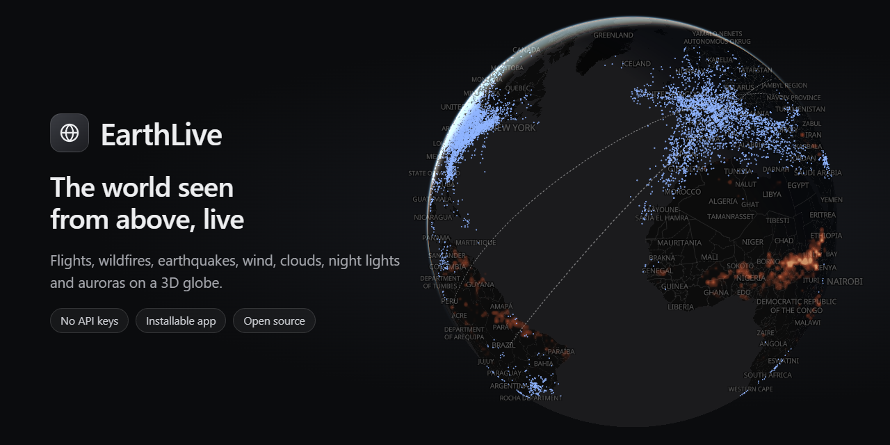
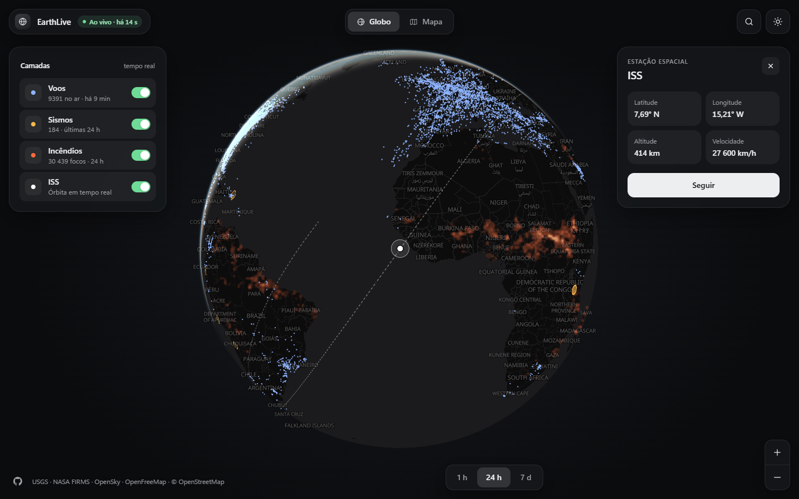
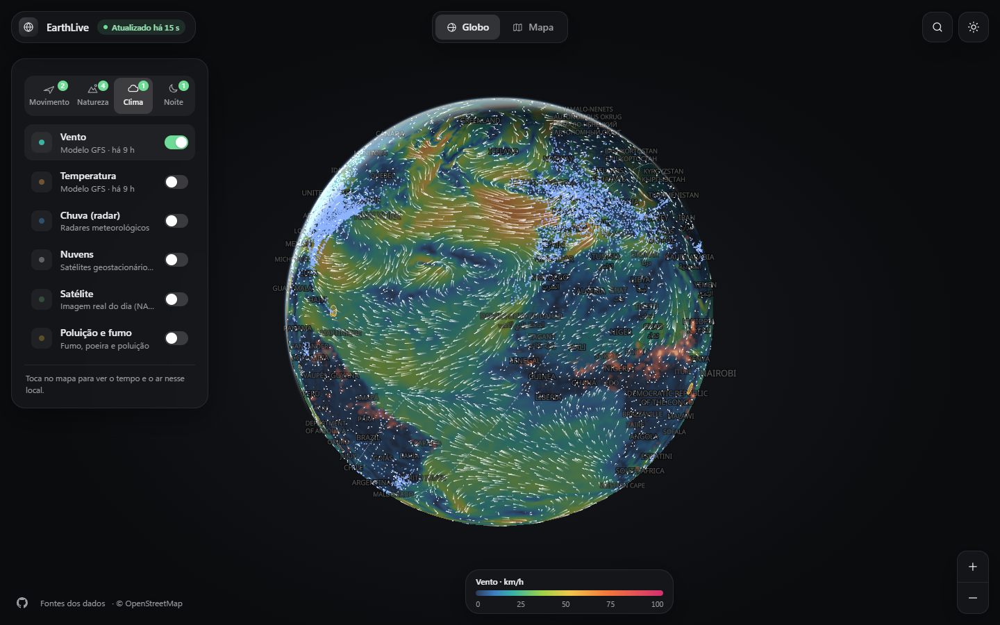
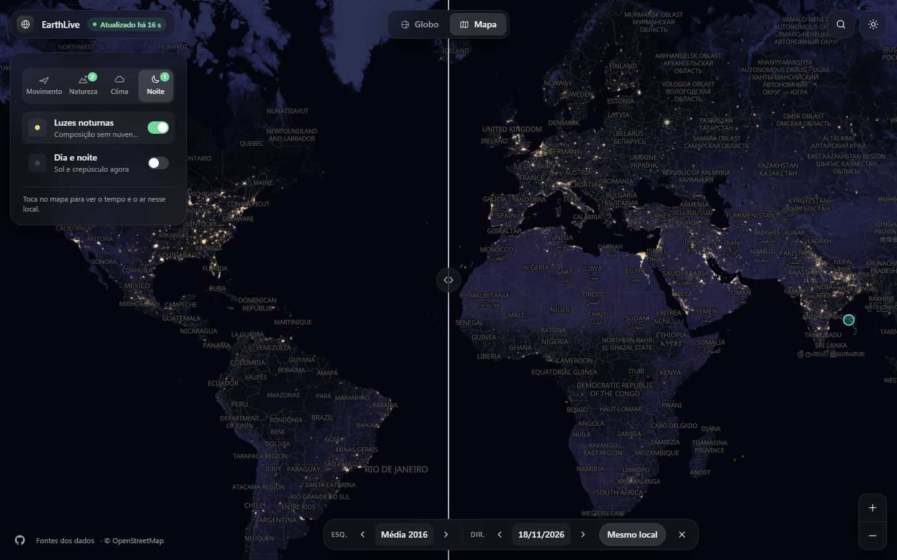
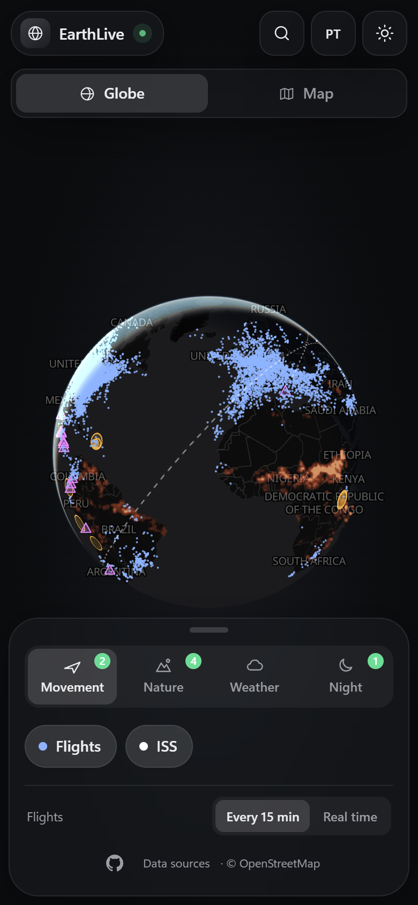
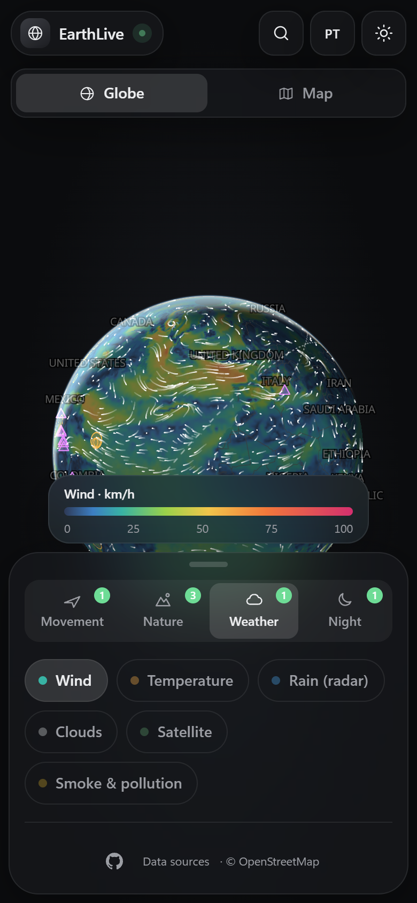
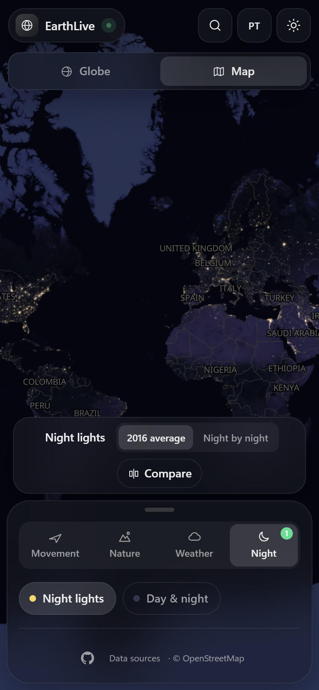
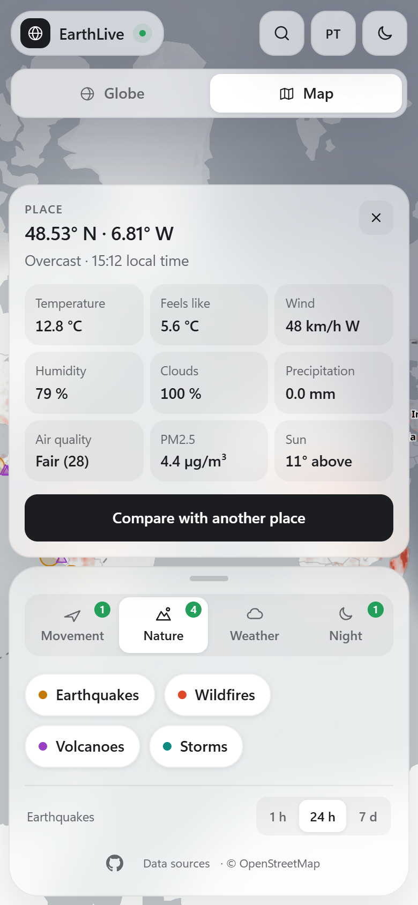

# EarthLive



**[Open EarthLive →](https://joaomrb.github.io/EarthLive/)**

The world seen from above, live: flights, earthquakes, wildfires, volcanoes, storms, wind, temperature, clouds, rain, air pollution, night lights, auroras and the International Space Station — on a 3D globe or a flat map.

| Globe | Map |
|---|---|
|  |  |
|  |  |

### On a phone

| Globe | Wind | Night lights | Weather at a place |
|:---:|:---:|:---:|:---:|
|  |  |  |  |

## Features

Layers are grouped in four themes:

- **Movement** — flights (OpenSky, animated between updates) and the ISS (orbit computed in the browser).
- **Nature** — earthquakes (USGS, 1 h / 24 h / 7 d), wildfires (NASA FIRMS), active volcanoes and storms with their track (NASA EONET).
- **Weather** — animated wind and temperature (NOAA GFS, current forecast hour), clouds (EUMETSAT, whole planet), rain radar (RainViewer), true-colour satellite image of the day and aerosols/pollution (NASA GIBS).
- **Night** — night lights (NASA Black Marble 2016 or any night since March 2024), **aurora forecast** (NOAA OVATION, next hour, with the Kp index) and live day/night with twilight.

Plus:

- **Compare dates side by side** with a draggable divider (e.g. a blackout, a holiday night, smoke before/after) — same place or two different places.
- **Tap anywhere** for the local weather, air quality, local time and Sun height — and **compare two places**.
- **Portuguese and English** (PT/EN button; follows the browser language by default), including the map labels.
- Search flights, places and the ISS. Globe ⇄ Map, light and dark themes, works on phones, no tracking, no cookies.

> Night lights are captured once per night (~01:30 local) at ~500 m resolution: they show cities and neighbourhoods switching on and off, not individual houses or real-time changes.

## Install as an app

EarthLive is a Progressive Web App: once installed it opens in its own window, without the browser's address bar, starts faster and still shows the last data when you are offline.

| Browser | How |
|---|---|
| Chrome, Edge, Brave, Opera, Samsung Internet (desktop & Android) | **Install app** link at the bottom of the page, or the install icon in the address bar |
| Safari on iPhone / iPad | Share → **Add to Home Screen** |
| Safari on Mac (17+) | File → **Add to Dock** |
| Firefox on Android | Menu → **Install** |
| Firefox on desktop | Limited or no app install (depends on version) — works as a normal website |

## How it works

The site is fully static and hosted on **GitHub Pages**.

| Data | Source | How it reaches the browser |
|---|---|---|
| Earthquakes | USGS | Fetched directly by the browser |
| ISS | wheretheiss.at / CelesTrak (TLE) | Fetched directly, position computed locally |
| Wildfires | NASA FIRMS public CSV | Snapshot built by a GitHub Action |
| Flights | OpenSky Network | **A:** snapshot every 15 min (GitHub Action) · **B:** real time via a Cloudflare Worker |
| Wind & temperature | NOAA GFS 1° (GRIB2) | Decoded by the GitHub Action into a small PNG, animated in the browser |
| Volcanoes & storms | NASA EONET | Fetched directly |
| Clouds | EUMETSAT world cloud map | Fetched directly (WMS), turned into transparent clouds in the browser |
| Rain radar | RainViewer | Fetched directly |
| Satellite, night lights, aerosols | NASA GIBS | Fetched directly (map tiles) |
| Weather & air at a point, place search | Open-Meteo | Fetched directly |
| Aurora forecast & Kp index | NOAA SWPC | Fetched directly |

OpenSky and FIRMS don't allow requests from other websites (no CORS), so they are fetched server-side: by the GitHub Action (option A) or by a tiny Cloudflare Worker (option B). When both are configured, visitors can choose between them in the layers panel.

```
.github/workflows/deploy.yml   build + data refresh + deploy (push and every 15 min)
scripts/fetch-data.mjs         builds public/data/flights.json, fires.json and weather.png
scripts/gfs.mjs                NOAA GFS download + pure-JS GRIB2 decoder
shared/opensky.mjs             OpenSky client shared by the Action and the Worker
worker/                        optional Cloudflare Worker (real-time flights)
src/                           the web app (Vite + TypeScript + MapLibre GL)
```

## Run locally

```bash
npm install
npm run data   # download the flight, wildfire and weather snapshots into public/data
npm run dev    # http://localhost:5173
```

## Deploy to GitHub Pages (option A)

1. Repository **Settings → Pages → Build and deployment → Source: GitHub Actions**.
2. Push to `main`. The *Deploy* workflow builds the site and refreshes the data every 15 minutes.
3. Optional: create a free [OpenSky API client](https://opensky-network.org/) and add `OPENSKY_CLIENT_ID` and `OPENSKY_CLIENT_SECRET` under **Settings → Secrets and variables → Actions → Secrets** for a higher rate limit.

> GitHub pauses scheduled workflows after 60 days without repository activity. Re-enable it from the Actions tab if that happens.

## Real-time flights (option B, optional)

1. Create a free Cloudflare account.
2. Edit `ALLOWED_ORIGINS` in [worker/wrangler.toml](worker/wrangler.toml) if your site URL is different.
3. Deploy:
   ```bash
   npx wrangler@4.165.0 login
   npm run worker:deploy
   # optional but recommended (anonymous OpenSky allows ~100 global requests/day):
   npx wrangler@4.165.0 secret put OPENSKY_CLIENT_ID --config worker/wrangler.toml
   npx wrangler@4.165.0 secret put OPENSKY_CLIENT_SECRET --config worker/wrangler.toml
   ```
4. In GitHub, add a repository **variable** (not a secret) `FLIGHTS_LIVE_URL` = `https://earthlive-flights.<your-subdomain>.workers.dev/flights` and re-run the workflow. A *“Real time” / “Tempo real”* option appears in the layers panel.

Without OpenSky credentials, set `CACHE_SECONDS` in `wrangler.toml` to `900` or more to stay within the anonymous limit.

## Security & privacy

- No API keys or passwords are in this repository or in the website bundle. Credentials only live in GitHub Secrets and Cloudflare Worker secrets.
- `VITE_*` variables are public by design — only put URLs there.
- The site sets no cookies and uses no analytics. Preferences (theme, view, layers) stay in the visitor's browser.

## Credits

Data: [USGS](https://earthquake.usgs.gov/), [NASA FIRMS](https://firms.modaps.eosdis.nasa.gov/), [NASA EONET](https://eonet.gsfc.nasa.gov/), [NASA GIBS](https://earthdata.nasa.gov/gibs), [NOAA GFS](https://www.nco.ncep.noaa.gov/pmb/products/gfs/), © [EUMETSAT](https://view.eumetsat.int/), [RainViewer](https://www.rainviewer.com/), [Open-Meteo](https://open-meteo.com/) (CC BY 4.0), [NOAA SWPC](https://www.swpc.noaa.gov/), [OpenSky Network](https://opensky-network.org/), [wheretheiss.at](https://wheretheiss.at/), [CelesTrak](https://celestrak.org/).
Maps: [OpenFreeMap](https://openfreemap.org/) · © [OpenStreetMap](https://www.openstreetmap.org/copyright) contributors.
Rendering: [MapLibre GL JS](https://maplibre.org/).

## License

[MIT](LICENSE)
