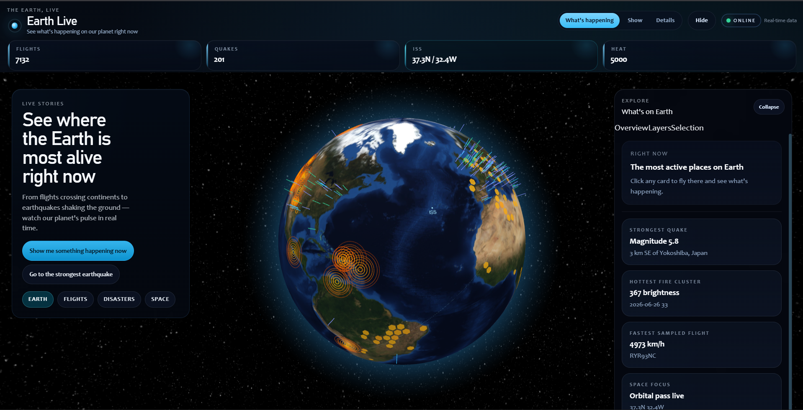

# Earth Live

Earth Live is a 3D globe that displays approximate live data from public sources: flights, earthquakes, wildfires, and the International Space Station. The project is intended to show geospatial visualization with a lightweight backend and browser rendering.

## Quick start

1. `npm install`
2. Copy `.env.example` to `.env`
3. `npm run dev`
4. Open `http://localhost:4200`

## Core stack

- Angular 19 SSR
- Node + Express
- Globe.gl + Three.js
- Tailwind CSS

## Notes

Data is fetched from public APIs and updates based on source availability.
