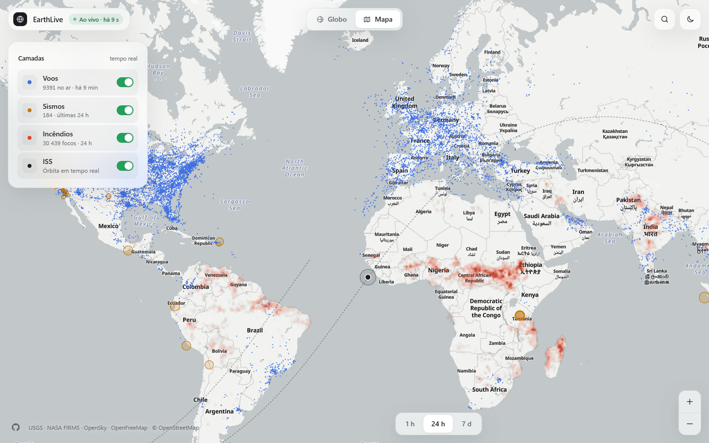

# EarthLive

Live flights, earthquakes, wildfires and the International Space Station — on a 3D globe or a flat map.

| Globe | Map |
|---|---|
|  |  |

## Features

- **Globe ⇄ Map** in one click (same engine, same data — MapLibre GL).
- **Flights** from OpenSky, animated between updates using heading and speed.
- **Earthquakes** from USGS (last hour / 24 h / 7 days).
- **Wildfires** from NASA FIRMS (VIIRS, last 24 h) — no API key required.
- **ISS** position and ground track, computed in the browser from its orbit (TLE).
- Light and dark themes, works on phones, no tracking, no cookies.

## How it works

The site is fully static and hosted on **GitHub Pages**.

| Data | Source | How it reaches the browser |
|---|---|---|
| Earthquakes | USGS | Fetched directly by the browser |
| ISS | wheretheiss.at / CelesTrak (TLE) | Fetched directly, position computed locally |
| Wildfires | NASA FIRMS public CSV | Snapshot built by a GitHub Action |
| Flights | OpenSky Network | **A:** snapshot every 15 min (GitHub Action) · **B:** real time via a Cloudflare Worker |

OpenSky and FIRMS don't allow requests from other websites (no CORS), so they are fetched server-side: by the GitHub Action (option A) or by a tiny Cloudflare Worker (option B). When both are configured, visitors can choose between them in the layers panel.

```
.github/workflows/deploy.yml   build + data refresh + deploy (push and every 15 min)
scripts/fetch-data.mjs         builds public/data/flights.json and fires.json
shared/opensky.mjs             OpenSky client shared by the Action and the Worker
worker/                        optional Cloudflare Worker (real-time flights)
src/                           the web app (Vite + TypeScript + MapLibre GL)
```

## Run locally

```bash
npm install
npm run data   # download the flight and wildfire snapshots into public/data
npm run dev    # http://localhost:5173
```

## Deploy to GitHub Pages (option A)

1. Repository **Settings → Pages → Build and deployment → Source: GitHub Actions**.
2. Push to `main`. The *Deploy* workflow builds the site and refreshes the data every 15 minutes.
3. Optional: create a free [OpenSky API client](https://opensky-network.org/) and add `OPENSKY_CLIENT_ID` and `OPENSKY_CLIENT_SECRET` under **Settings → Secrets and variables → Actions → Secrets** for a higher rate limit.

> GitHub pauses scheduled workflows after 60 days without repository activity. Re-enable it from the Actions tab if that happens.

## Real-time flights (option B, optional)

1. Create a free Cloudflare account.
2. Edit `ALLOWED_ORIGINS` in [worker/wrangler.toml](worker/wrangler.toml) if your site URL is different.
3. Deploy:
   ```bash
   npx wrangler@4.165.0 login
   npm run worker:deploy
   # optional but recommended (anonymous OpenSky allows ~100 global requests/day):
   npx wrangler@4.165.0 secret put OPENSKY_CLIENT_ID --config worker/wrangler.toml
   npx wrangler@4.165.0 secret put OPENSKY_CLIENT_SECRET --config worker/wrangler.toml
   ```
4. In GitHub, add a repository **variable** (not a secret) `FLIGHTS_LIVE_URL` = `https://earthlive-flights.<your-subdomain>.workers.dev/flights` and re-run the workflow. A *“Tempo real”* option appears in the layers panel.

Without OpenSky credentials, set `CACHE_SECONDS` in `wrangler.toml` to `900` or more to stay within the anonymous limit.

## Security & privacy

- No API keys or passwords are in this repository or in the website bundle. Credentials only live in GitHub Secrets and Cloudflare Worker secrets.
- `VITE_*` variables are public by design — only put URLs there.
- The site sets no cookies and uses no analytics. Preferences (theme, view, layers) stay in the visitor's browser.

## Credits

Data: [USGS](https://earthquake.usgs.gov/), [NASA FIRMS](https://firms.modaps.eosdis.nasa.gov/), [OpenSky Network](https://opensky-network.org/), [wheretheiss.at](https://wheretheiss.at/), [CelesTrak](https://celestrak.org/).
Maps: [OpenFreeMap](https://openfreemap.org/) · © [OpenStreetMap](https://www.openstreetmap.org/copyright) contributors.
Rendering: [MapLibre GL JS](https://maplibre.org/).

## License

[MIT](LICENSE)
